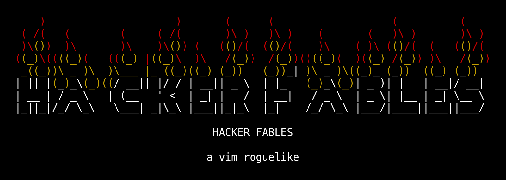

# 🥷💻 Hacker Fables - A Vim Roguelike

<p align="center">
  
</p>

https://github.com/user-attachments/assets/a5244548-b785-4035-a98d-94299f6b0346

_The game you can't quit playing ;)_


[](LICENSE) [](https://sebastiancarlos.github.io/hacker-fables-game/)

Hacker Fables is a **terminal and browser roguelike** where **Vim keybindings
are martial arts** and you wield weapons like the **Modal Shotgun**. Descend
through Bell Labs, defeat the code-snakes, and destroy the eldritch
abomination at the bottom.

[**Play it online
here.**](https://sebastiancarlos.github.io/hacker-fables-game/)

The game runs both in a terminal and in the browser (through `xterm.js`).

## Game Features

- **Vim is the combat system.** Do you miss the days of flexing your Vim
  motion skills now that LLM agents write most of your code? This game is for
  you! Move with `hjkl` (or arrows, for Emacs users), run with counts or
  shifted keys (`HJKL`), fire your shotgun via `INSERT BULLET` or `VISUAL
BLOCK` modes, repeat the last action with `.`
- **The Modal Shotgun.** The ultimate Vim user fantasy! Enter `VISUAL BLOCK`
  mode, select a swarm of enemies (use esoteric controls like `^`, `$`, `gg`,
  `G` to taste), and see them all blow up into tiny pixels.
- **Magic Scrolls are Regex Scripts.** Execute `s///` commands that delete
  enemies or restore your health by pure regex logic.
- **Python bestiary.** Fight snake monsters which get more powerful depending
  on their Python version. Face the infamous walrus operator.
- **A coffee break roguelike.** Procedural levels, one life per run, but still
  easy to play to the end in one go.
- **Static and private.** The game runs without a backend (for now), and your
  data stays on your machine. No PII or telemetry will ever be collected.

Hacker Fables is currently in **alpha**, so expect rough edges and changes
between releases. Feel free to open issues for bugs or feature requests.

## Requirements

- Node.js 24 or newer
- A terminal with at least 80x25 (ubiquitous since the 1960s), or a web
  browser

## Play in the terminal

```sh
git clone https://github.com/sebastiancarlos/hacker-fables-game.git
cd hacker-fables-game
npm start
```

## Play in the browser

Play the hosted build at
<https://sebastiancarlos.github.io/hacker-fables-game/>.

To run it locally:

```sh
npm run dev
```

Then open `http://localhost:5173` in your browser.

A production build is also available:

```sh
npm run build
npm run preview
```

## Main Controls

| Key                       | Action                    |
| ------------------------- | ------------------------- |
| `h` `j` `k` `l` or arrows | Move                      |
| `Shift` + direction       | Run until disturbed       |
| `5j`, `12l`               | Run up to that many steps |
| `,`                       | Pick up                   |
| `E`                       | Equip                     |
| `i`                       | Enter INSERT BULLET mode  |
| `f`                       | Fire                      |
| `Ctrl-V`                  | Enter VISUAL BLOCK mode   |
| `.`                       | Repeat the last action    |
| `/`                       | Look                      |
| `I`                       | Inventory                 |
| `M`                       | Message log               |
| `?`                       | Help                      |
| `q`                       | Quit (easier than Vim!)   |

The rest can be found in-game via `?`.

## Technical Features

- **Deterministic runs.** A run is a seed plus the keys passed into the game.
  Recordings store it and replay exactly what was played. A finished run can
  be watched again trivially.
- **Simulation and presentation split.** Logic mutates a single `GameState`.
  The presenter reads it and paints an internal representation of cells. The
  platform layer turns those into ANSI or `xterm.js` output.
- **Frame buffer rendering.** A frame buffer diffs each new frame against the
  last, and the terminal receives only the changed runs (basically the
  infamous React.js diff, but for a roguelike game).
- **One game model, two front ends.** The terminal and browser adapters use
  the exact same engine.
- **Platform-neutral core.** OS process IO and browser storage are provided
  through adapters. The game loop never touches `stdin`, `stdout`, or a
  browser's `window`.

## Development

```sh
npm ci
npm run format
npm run typecheck
npm test
```

`npm test` runs the unit suite and the terminal end-to-end suite. The browser
end-to-end suite uses Playwright with Chromium:

```sh
npx playwright install --with-deps chromium
npm run test:e2e
```

Scores, morgue dumps, and replay recordings are written under
`$XDG_DATA_HOME/hacker-fables`. Configurable via `HACKER_FABLES_DATA`.

## ☕ Coffeeware Disclaimer

Hacker Fables will always be fully free and FOSS. If you like the game and
want to support it, you can [buy me a
coffee.](https://ko-fi.com/sebastiancarlos)

You can also check the free [novel which inspired this game, **Hacker
Fables**](https://sebastiancarlos.github.io/hacker-fables). I aim to expand
the game into an ambitious, multi-paradigm adaptation of the source material.

## Privacy Disclaimer

Hacker Fables is static and has no backend. Scores, morgue dumps, and replay
recordings stay on the local user machine or in the browser's `localStorage`.
No PII or telemetry is collected.

## File Structure

```txt
hacker-fables-game/
├── src/
│   ├── main.ts              # terminal entry point
│   ├── web.ts               # browser entry point (xterm.js)
│   ├── game.ts              # game loop, key intake, replay wiring
│   ├── game-state.ts        # the game state
│   ├── input.ts             # key input
│   ├── keymap.ts            # key-binding table
│   ├── key.ts               # normalized key input into IR
│   ├── terminal-input.ts    # terminal-centric input decoder
│   ├── modes.ts             # orchestrates several game "modes"
│   ├── movement.ts          # movement logic
│   ├── combat.ts            # melee and ranged combat logic
│   ├── items.ts             # items definition and logic
│   ├── inventory.ts         # pickup, equip
│   ├── monsters.ts          # some enemy info
│   ├── enemies.ts           # more enemy info
│   ├── world.ts             # level layout and population
│   ├── levels.ts            # level arrival handling
│   ├── vision.ts            # casting sight and memory
│   ├── rng.ts               # RNG store
│   ├── geometry.ts          # distances, paths, GUI panels
│   ├── grid.ts              # IR and logic of some layout-centric tiles
│   ├── render.ts            # screen painting
│   ├── screen.ts            # screen interface and ANSI writer
│   ├── frame-buffer.ts      # frame buffer and diff system
│   ├── style.ts             # semantic colors and text
│   ├── theme.ts             # colors and other theme-related values
│   ├── text.ts              # wrapping, column layout, etc
│   ├── content.ts           # most of the game text copy
│   ├── messages.ts          # events for the live message line
│   ├── events.ts            # simulation actions
│   ├── commands.ts          # vim commands tally logic
│   ├── pager.ts             # GUI such as pagers, menus, confirm popups
│   ├── help.ts              # in-game help and reference
│   ├── look.ts              # look mode logic
│   ├── aim.ts               # cursor and visual block logic
│   ├── title.ts             # title page logic
│   ├── endgame.ts           # death screen logic
│   ├── end-keys.ts          # more death screen logic
│   ├── score.ts             # record and high scores logic
│   ├── dump.ts              # morgue report generation
│   ├── recording.ts         # recording serialization
│   ├── replay.ts            # recording playback
│   ├── progression.ts       # XP curve, ranks, etc
│   ├── progress.ts          # more XP curve, ranks, etc
│   ├── queries.ts           # read-only game state lookup helpers
│   ├── cli.ts               # CLI flags handling
│   ├── platform.ts          # terminal IO and file storage
│   ├── platform-web.ts      # browser storage and xterm adapter
│   └── index.ts             # shim for tests
├── test/                    # test suite for terminal and browser
├── index.html               # Vite page shell
├── vite.config.ts           # web build config
├── playwright.config.ts     # Chromium browser test config
├── tsconfig.json
├── package.json
└── README.md
```

## License

MIT
